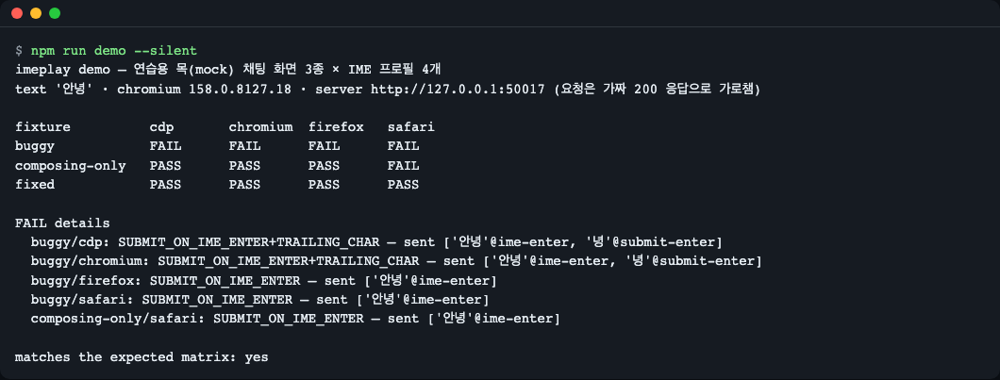
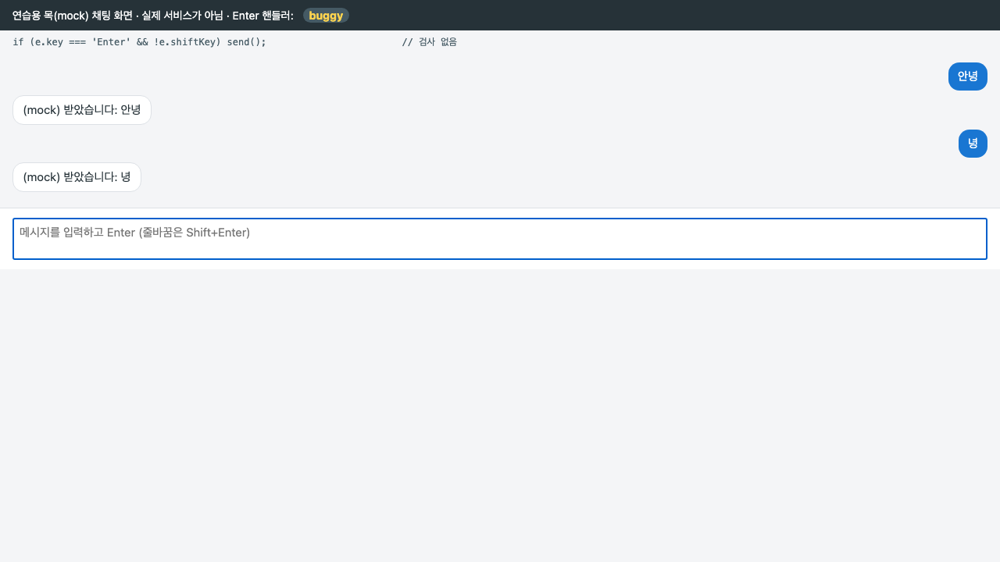
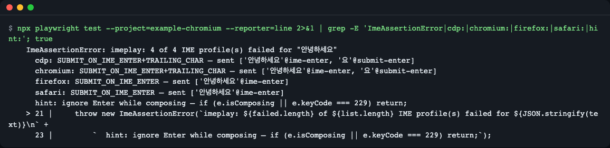
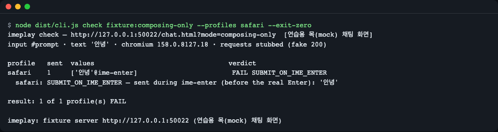
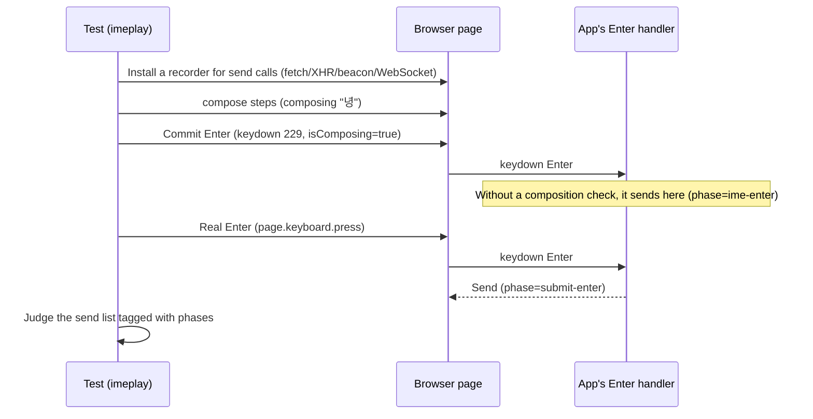
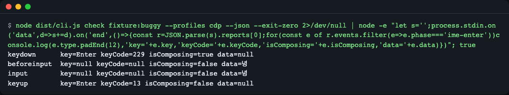

# imeplay

[한국어](README.md) | **English**

imeplay reproduces Korean IME composition inside Playwright tests, so you can catch chat inputs that send twice or re-send the last character when the user presses Enter to confirm a syllable. Use it as a library in your own Playwright tests or as a CLI (`imeplay check <url>`; `--steps FILE` also checks non-Korean compositions such as Japanese or Chinese from a JSON step file). Quick start: `npm install && npx playwright install chromium && npm run demo`. Not published to npm yet; install from GitHub. Chromium is verified locally; Firefox and WebKit run in the CI matrix.

It reproduces, in automated tests, and catches the bug where you type "안녕" in Korean and press Enter, and the chat box sends both "안녕" and "녕" (the last syllable) as two messages.


*`npm run demo` — the result of checking 3 practice (mock) chat screens with 4 IME profiles. buggy is all FAIL, and the properly fixed one, fixed, is all PASS.*

## Who it's for
- When you build a screen that sends on Enter after Korean (CJK) input in a chat or search box, and want to stop that regression in CI
- When Playwright's `keyboard.type` / `fill` could not reproduce this bug and you were stuck
- When you want to throw a single `imeplay check` line at someone else's screen URL and see whether "Enter sends twice"

## Why Playwright alone isn't enough
Korean does not enter a character in one go; it passes through a "composing" state. If you press Enter while the last character (for example, "녕") is still being composed, the browser sends "composition commit" and "Enter" separately. It is like the "I'm done" signal reaching the vending machine before you have finished inserting all the coins. If the app cannot tell this Enter apart, a send happens once early, and once more with the leftover character after the composition is committed.

`page.keyboard.press('Enter')` and `fill` do not create a composing state, so this order never occurs. imeplay feeds composition events (compositionstart, update, end, keydown 229) in the real order.


*The buggy mode of the practice mock screen. This is not a real service but a fake chat screen the repo provides, and the last character "녕" was sent one extra time.*

## Install
It has not been published to npm yet. Install it from GitHub. Prerequisite: Node.js 22.12 or later.

```bash
# Install Node (macOS example: brew install node; on Linux use nvm etc.)
npm install -D github:LeeGyeongPil/imeplay @playwright/test@1.65.0
npx playwright install chromium
```
- At install time, `prepare` builds the TypeScript. npm 11 may show an `install-scripts` warning, which is normal.
- To use a clone: `git clone https://github.com/LeeGyeongPil/imeplay && cd imeplay && npm install && npx playwright install chromium`. To put it into another project, take the `imeplay-0.2.0.tgz` made with `npm pack` and run `npm install -D ./imeplay-0.2.0.tgz @playwright/test@1.65.0`.
- If a browser must launch on minimal Linux (a container), use `npx playwright install --with-deps chromium`.
- `playwright` is a peer dependency (`>=1.65.0 <2`). The `@playwright/test` in the install line above pulls in `playwright` too, so you don't need to install it separately. If you use only the CLI and `checkIme` without a test runner, you can install just `playwright@1.65.0` instead of `@playwright/test`.
- Both ESM and CommonJS projects load it with `import { checkIme } from 'imeplay'` or `require('imeplay')` (Node 22.12+; `require` loads ESM synchronously).

## Quick start
In the cloned folder:

```bash
npm install
npx playwright install chromium
npm run demo
```
The same table as the first screen above appears in about 3 seconds. How to read the table:

| Row | Meaning |
|---|---|
| `buggy` | The Enter handler has no composition check → every profile FAILs |
| `composing-only` | A half fix that checks only `isComposing` → FAILs only in the Safari-style order |
| `fixed` | Checks both `isComposing` and `keyCode === 229` → all PASS |

This demo is the **practice mock mode**. The screen is this repo's fake chat screen, the send request is intercepted with a fake 200 response, and no real server or LLM is used. Even when checking a real URL, the default is the same interception (see `--passthrough` below).

## Usage

### Putting it into your Playwright tests
This is code using the same API as [`examples/chat-input.spec.ts`](examples/chat-input.spec.ts) in the repository (with the server start moved into the test). In a real app, change `page.goto` to your own screen's address.

```ts
import { test } from '@playwright/test';
import { checkIme, expectSingleSubmit, startFixtureServer } from 'imeplay';

test('한국어 입력 후 Enter 는 한 번만 전송', async ({ page }) => {
  const server = await startFixtureServer();           // Practice mock screen (not needed for your own app)
  try {
    await page.goto(`${server.url}/chat.html?mode=fixed`);
    const report = await checkIme(page, {
      input: '#prompt',          // Input box selector (required)
      text: '안녕하세요',          // The last character must be a Hangul syllable
      profiles: 'auto',          // All IME profiles that fit the browser
      request: '**/api/chat',    // The request to count as a "send" (if omitted, every non-GET request)
    });
    expectSingleSubmit(report);  // Even one mismatch raises ImeAssertionError
  } finally {
    await server.close();
  }
});
```

(The test title `'한국어 입력 후 Enter 는 한 번만 전송'` means "after Korean input, Enter sends only once.")

When it fails, you get a message like this (against the buggy screen).


*Part of the error text from `IMEPLAY_EXAMPLE_MODE=buggy npx playwright test --project=example-chromium`. `sent [value@phase]` shows "what was sent, and when."*

To run only the example, use `npx playwright test --project=example-chromium`.

### Checking any screen (CLI)
```bash
npx imeplay check https://내-앱.example/chat --input '#prompt' --request '**/api/chat'
npx imeplay check fixture:composing-only --profiles safari --exit-zero
```
(`내-앱` in the first URL means "my-app"; replace it with your own app's address.)


*A fix that only looks at `isComposing` sends before the real Enter in the Safari-style order. It is `--exit-zero`, so the exit code is 0.*

For text that is not Korean (Japanese, Chinese, and so on), write the composition steps yourself in a JSON file and pass it with `--steps`. The last step must be `compose` (imeplay does the commit with Enter), and if the format is wrong, it ends before launching the browser with a one-line `imeplay: --steps: …` and exit code 2. The `commit` and `insert` steps also need `text`. Below is a Japanese example. If you installed from GitHub without cloning the repo, there is no `tests/fixtures/`, so create the content below yourself as a `steps-ja.json` file (if you cloned, it is included as `tests/fixtures/steps-ja.json`). The step file (`steps-ja.json`):
```json
[
  { "type": "compose", "text": "に" },
  { "type": "compose", "text": "にほ" },
  { "type": "compose", "text": "にほん" },
  { "type": "compose", "text": "日本" }
]
```
```bash
npx imeplay check fixture:composing-only --steps steps-ja.json --profiles safari,firefox
```
```text
profile   sent  values                                  verdict
safari    1     ['日本'@ime-enter]                        FAIL SUBMIT_ON_IME_ENTER
firefox   1     ['日本'@submit-enter]                     PASS
  safari: SUBMIT_ON_IME_ENTER — sent during ime-enter (before the real Enter): '日本'

result: 1 of 2 profile(s) FAIL
```
The exit code is 1. It uses the same verdict method as the Korean example, and it does not convert romaji to kana, so you write `text` for each step yourself.

| Option | What it does | Default |
|---|---|---|
| `demo` | The matrix of 3 practice screens x 4 profiles | - |
| `check <url \| fixture:buggy\|composing-only\|fixed>` | Check one screen | - |
| `--input SEL` | Input box selector | fixture `#prompt`, URL `textarea` |
| `--text TEXT` | The text to type (ending in a Hangul syllable) | `안녕` |
| `--steps FILE` | A file with a JSON ImeStep array (compose/commit/insert). Cannot be used together with `--text` | None |
| `--profiles LIST` | `auto` or `cdp,chromium,firefox,safari` | `auto` |
| `--request GLOB` | URL glob to count as a "send" | Every non-GET request |
| `--passthrough` | Send requests to the real server without intercepting | Off (fake 200) |
| `--browser NAME` | `chromium` \| `firefox` \| `webkit` | `chromium` |
| `--json` | JSON report on stdout (including the event log) | Off |
| `--exit-zero` | Exit code 0 even on FAIL | Off |
| `--timeout SEC` | After this time, clean up and exit with code 2 | 60 |
| `--screenshots DIR` | Save PNGs | Off |
| `--chromium-arg=ARG` | A Chromium argument (must be attached with `=`) | None |

Exit codes: 0 all PASS, 1 there is a FAIL, 2 usage or runtime error or timeout.

### Kinds of verdicts
| Code | Symptom the user experiences |
|---|---|
| `NO_SUBMIT` | Nothing is sent even when Enter is pressed |
| `SUBMIT_ON_IME_ENTER` | Sent on the Enter that commits the composition (sent before the real Enter) |
| `DOUBLE_SUBMIT` | One keystroke, but the same text is sent twice |
| `TRAILING_CHAR` | Only the last character is sent once more on its own ("녕" after "안녕") |
| `WRONG_VALUE` | The text sent differs from the text typed |

### Library API summary
| Name | What it does |
|---|---|
| `checkIme(page, opts)` | For each profile, reopens the same URL, records and judges the send after composed input, and returns `ImeReport[]`. You must do `page.goto()` first |
| `expectSingleSubmit(reports)` | Raises `ImeAssertionError` if any is not PASS (an empty array also fails) |
| `typeWithIme(page, selector, text, opts?)` | Only composed input, with no verdict. Commit Enter with `pressEnterDuringComposition()` |
| `koreanSteps(text)` / `validateSteps(steps)` | Break Korean into 2-set (dubeolsik) composition steps (`compose`, `commit`, `insert`) / validate them |
| `judge(expected, submissions)` | Only the verdict, from send records |
| `startFixtureServer()` | Practice mock screen server (127.0.0.1, shuts itself down after 120 seconds idle or at most 600 seconds) |

Options of `checkIme`: `input` (required), `text`, `steps`, `profiles` (`'auto'` or an array), `request`, `passthrough`, `recordEvents`, `timeout` (ms, default 30000).

## Settings
| Name | What it does |
|---|---|
| `IMEPLAY_CHROMIUM_ARGS` | Arguments to pass to Chromium (separated by spaces). Passes nothing if empty |
| `IMEPLAY_BROWSERS` | The browsers this repo's tests run (default `chromium`) |
| `IMEPLAY_EXAMPLE_MODE` | The practice screen the `examples/` spec opens (default `fixed`) |
| `IMEPLAY_DEBUG=1` | Print CLI errors in full, including browser logs |

No API key is needed. All screens and responses run locally, and even for a real URL, requests are blocked with a fake 200 by default.

### Running in a sandbox or container
In an environment where Chromium cannot start because of sandbox restrictions, pass the arguments through an environment variable.

```bash
IMEPLAY_CHROMIUM_ARGS="--single-process --no-zygote" npm run demo
```
Note: a `--single-process` Chromium can die if you create a second BrowserContext. You don't need it in a normal environment.

`IMEPLAY_CHROMIUM_ARGS` applies only to the imeplay CLI and this repo's tests. For your own Playwright tests (the `page` fixture), put it directly in `playwright.config.ts`.

```ts
import { defineConfig } from '@playwright/test';
export default defineConfig({
  use: { launchOptions: { args: ['--single-process', '--no-zygote'] } },
});
```
With these flags only one context can be created per browser, so the `page` fixture, which creates a new context for every test, is safe only when there is a single test (with several it can die). Use it only where you really need it.

## How it works

1. It wraps the send functions inside the page and records the phase at the moment of the call (`typing` / `ime-enter` / `submit-enter`). It judges deterministically, with no wall-clock waiting.
2. For Chromium, the `cdp` profile goes through the real browser input path with a CDP command (`Input.imeSetComposition`).
3. Otherwise, the synthetic profiles (`chromium`, `firefox`, `safari`) build and send the events directly. `safari` imitates the order in which composition ends before keydown, so it appears as `isComposing=false`.
4. Requests are intercepted with a fake 200 response by default (except GET, HEAD, and OPTIONS), and when `checkIme` finishes, it removes the interception and the recorder.

The commit-Enter order on the buggy screen in real Chromium (the event log of `check fixture:buggy --profiles cdp --json`):


*`keydown` arrives first with `keyCode=229, isComposing=true`. That you must filter on these values is the basis of the fix below.*

### The fix in one line
```js
if (e.isComposing || e.keyCode === 229) return;   // Ignore Enter during composition
```
Looking only at `isComposing` breaks in the Safari-style order (keydown after composition ends), so look at `keyCode === 229` as well.

## Limitations
- Synthetic events have `isTrusted=false`. For apps that filter such events, go by the `cdp` profile's result.
- `cdp` uses experimental CDP commands. They may change with the Chromium version, so we pinned Playwright to 1.65.0 when checking.
- Firefox and WebKit use only the synthetic profiles, and running on real Firefox and WebKit browsers could not be confirmed in this environment; it is set up to be confirmed in the CI matrix (GitHub Actions). Local verification is Chromium only.
- It does not bring up the real OS IME; it reproduces the order of composition events.
- If the `--steps` file starts with a UTF-8 BOM, it is rejected as a JSON format error, and the message does not tell you the cause (the BOM) separately. Save it without a BOM.
- If you pass non-Korean text with `--text`, the error comes only after the browser has launched (`--steps` is checked before the browser). Use `--steps` for such text.
- The synthetic profiles support only `textarea` and `input` (`contenteditable` is not supported).
- If the request body contains the whole conversation history, the value verdict can go off (the count verdict is kept).
- The fake response is a `{reply, imeplay:'stub'}` JSON. An app that expects a different response format (for example, streaming) may show an error on screen, but the verdict is unaffected. WebSocket sends are only recorded, not intercepted.
- If you check a real URL with `--passthrough`, messages go to the real server, so billing and delay can occur, and it may be slow depending on network speed. That is why `--timeout` (default 60 seconds) exists.

## When to use it
- Use it when: you want to stop the Korean-input-then-Enter send regression with a Playwright E2E test, or quickly check which input boxes send only once.
- Use another tool when: general key-input and form tests → the [Playwright docs](https://playwright.dev/docs/input); checks done by typing with the real OS IME → manual testing.

## Troubleshooting
| Symptom | Cause | Fix |
|---|---|---|
| `browserType.launch: Target page, context or browser has been closed` (the imeplay CLI prints `could not start chromium: …` along with a hint) | The browser dies right after starting because of sandbox or container restrictions | `IMEPLAY_CHROMIUM_ARGS="--single-process --no-zygote"` (see the note above). For your own tests, `launchOptions.args` |
| `No tests found` | `@playwright/test` is not installed, or the spec file name is not `*.spec.ts` | Check `@playwright/test` in the install line |
| `executable doesn't exist` | The browser is not installed | `npx playwright install chromium` |
| Exit code 2 and `timeout after Ns` | The input box selector doesn't match, or the screen is slow | Check `--input`, increase `--timeout` |
| `--chromium-arg --flag` is rejected | The value starts with `--` | Attach it with `=`, like `--chromium-arg=--flag` |
| Rejected with a `text` error | The last character is not a Hangul syllable | End with Korean (for example, `안녕`). For Japanese, Chinese, and so on, use a `--steps` step file |
| Every profile is NO_SUBMIT | The `request` glob doesn't match the real send URL | Remove `--request` or match it to the URL |

## Development and contributing
```bash
npm install
npx playwright install chromium
npm test        # Build + type check + Playwright tests (63 pass; 1 runs only on Firefox and WebKit in CI)
```
In a sandbox environment, prefix it with `IMEPLAY_CHROMIUM_ARGS="--single-process --no-zygote"`. CI is a matrix of Node 22 and 24 x Chromium, Firefox, and WebKit. Please leave bugs and suggestions as issues. The change log is [CHANGELOG.md](CHANGELOG.md).

## Learn more
- Playwright docs: https://playwright.dev/docs/intro (checked 2026-11-10)
- MDN `KeyboardEvent.isComposing`: https://developer.mozilla.org/docs/Web/API/KeyboardEvent/isComposing (checked 2026-11-10)
- Chrome DevTools Protocol `Input.imeSetComposition`: https://chromedevtools.github.io/devtools-protocol/tot/Input/ (checked 2026-11-10)

## License
MIT. No external models or data are used.
