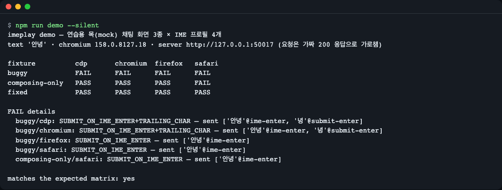
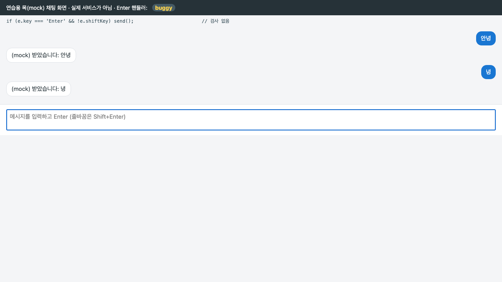
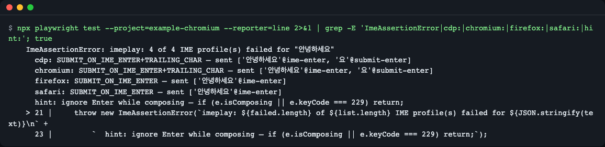
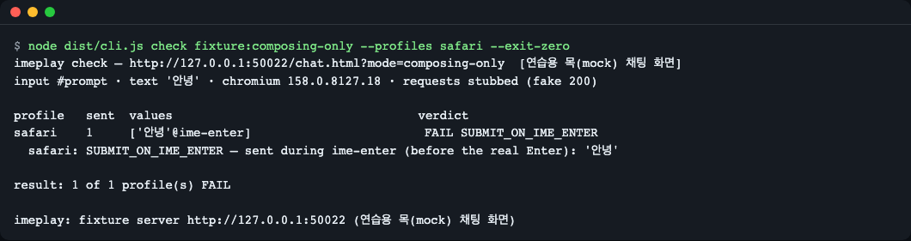
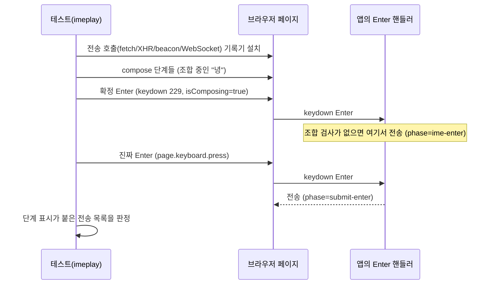
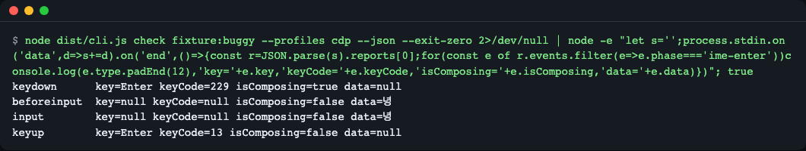

# imeplay

> **English summary** — imeplay reproduces Korean IME composition inside Playwright tests, so you can catch chat inputs that send twice or re-send the last character when the user presses Enter to confirm a syllable. Use it as a library in your own Playwright tests or as a CLI (`imeplay check <url>`). Quick start: `npm install && npx playwright install chromium && npm run demo`. Not published to npm yet; install from GitHub. Chromium is verified locally; Firefox and WebKit run in the CI matrix.

한국어로 "안녕"을 치고 Enter 를 눌렀는데 채팅창에서 "안녕" 과 "녕" 이 두 번 전송되는 버그를, 자동화 테스트에서 재현하고 잡아 줍니다.


*`npm run demo` — 연습용 목(mock) 채팅 화면 3종을 IME 프로필 4개로 점검한 결과. buggy 는 전부 FAIL, 제대로 고친 fixed 는 전부 PASS.*

## 이런 분께
- 채팅·검색 입력창에서 한글(CJK) 입력 후 Enter 로 전송하는 화면을 만들고, 그 회귀를 CI 에서 막고 싶을 때
- Playwright 의 `keyboard.type` / `fill` 로는 이 버그가 재현되지 않아 곤란했을 때
- 남의 화면 URL 에 `imeplay check` 한 줄만 던져 "Enter 로 두 번 가는지" 보고 싶을 때

## 왜 Playwright 만으로는 안 되나
한글은 글자를 한 번에 넣지 않고 "조합 중" 상태를 거칩니다. 마지막 글자(예: "녕")가 조합 중일 때 Enter 를 누르면 브라우저는 "조합 확정" 과 "Enter" 를 따로 보냅니다. 자판기에 동전을 다 넣기도 전에 "다 넣었다" 신호가 먼저 가는 것과 같습니다. 앱이 이 Enter 를 구분하지 못하면 전송이 일찍 한 번, 조합이 확정된 뒤 남은 글자로 또 한 번 일어납니다.

`page.keyboard.press('Enter')` 나 `fill` 은 조합 상태를 만들지 않기 때문에 이 순서가 나오지 않습니다. imeplay 는 조합 이벤트(compositionstart·update·end, keydown 229)를 실제 순서로 흘려 줍니다.


*연습용 목 화면의 buggy 모드. 실제 서비스가 아니라 이 레포가 제공하는 가짜 채팅 화면이며, 마지막 글자 "녕" 이 한 번 더 전송됐습니다.*

## 설치
npm 에는 아직 게시하지 않았습니다. GitHub 에서 설치합니다. 전제: Node.js 22.12 이상.

```bash
# Node 설치 (macOS 예: brew install node, 리눅스는 nvm 등 사용)
npm install -D github:LeeGyeongPil/imeplay @playwright/test@1.65.0
npx playwright install chromium
```
- 설치 때 `prepare` 가 TypeScript 를 빌드합니다. npm 11 은 `install-scripts` 경고를 띄울 수 있고, 정상입니다.
- clone 해서 쓰려면: `git clone https://github.com/LeeGyeongPil/imeplay && cd imeplay && npm install && npx playwright install chromium`. 다른 프로젝트에 넣을 때는 `npm pack` 으로 만든 `imeplay-0.1.0.tgz` 를 `npm install -D ./imeplay-0.1.0.tgz @playwright/test@1.65.0` 합니다.
- 최소 리눅스(컨테이너)에서 브라우저가 떠야 한다면 `npx playwright install --with-deps chromium` 을 씁니다.
- `playwright` 는 peer 의존성(`>=1.65.0 <2`)입니다. 위 설치 줄의 `@playwright/test` 가 `playwright` 를 함께 끌어오므로 따로 설치하지 않아도 됩니다. 테스트 러너 없이 CLI 와 `checkIme` 만 쓴다면 `@playwright/test` 대신 `playwright@1.65.0` 만 설치해도 됩니다.
- ESM·CommonJS 프로젝트 모두 `import { checkIme } from 'imeplay'` 또는 `require('imeplay')` 로 불러옵니다(Node 22.12+, `require` 는 ESM 을 동기 로드합니다).

## 빠르게 시작하기
clone 한 폴더에서:

```bash
npm install
npx playwright install chromium
npm run demo
```
위 첫 화면과 같은 표가 약 3초 안에 나옵니다. 표를 읽는 법:

| 줄 | 의미 |
|---|---|
| `buggy` | Enter 핸들러에 조합 검사가 없음 → 모든 프로필 FAIL |
| `composing-only` | `isComposing` 만 확인하는 반쪽 수정 → Safari 방식 순서에서만 FAIL |
| `fixed` | `isComposing` 과 `keyCode === 229` 를 함께 확인 → 모두 PASS |

이 데모는 **연습용 목(mock) 모드**입니다. 화면도 이 레포의 가짜 채팅 화면이고, 전송 요청은 가짜 200 응답으로 가로채며 실제 서버·LLM 은 쓰지 않습니다. 실제 URL 을 점검할 때도 기본은 같은 가로채기입니다(아래 `--passthrough`).

## 사용법

### 내 Playwright 테스트에 넣기
저장소의 [`examples/chat-input.spec.ts`](examples/chat-input.spec.ts) 와 같은 API 를 쓰는 코드입니다(서버 시작을 테스트 안으로 옮김). 실제 앱에서는 `page.goto` 를 내 화면 주소로 바꾸세요.

```ts
import { test } from '@playwright/test';
import { checkIme, expectSingleSubmit, startFixtureServer } from 'imeplay';

test('한국어 입력 후 Enter 는 한 번만 전송', async ({ page }) => {
  const server = await startFixtureServer();           // 연습용 목 화면 (내 앱이면 필요 없음)
  try {
    await page.goto(`${server.url}/chat.html?mode=fixed`);
    const report = await checkIme(page, {
      input: '#prompt',          // 입력창 선택자 (필수)
      text: '안녕하세요',          // 마지막 글자는 한글 음절이어야 함
      profiles: 'auto',          // 브라우저에 맞는 IME 프로필 전부
      request: '**/api/chat',    // "전송" 으로 칠 요청 (생략하면 GET 이 아닌 모든 요청)
    });
    expectSingleSubmit(report);  // 한 번이라도 어긋나면 ImeAssertionError
  } finally {
    await server.close();
  }
});
```

실패하면 이런 메시지가 나옵니다(buggy 화면 대상).


*`IMEPLAY_EXAMPLE_MODE=buggy npx playwright test --project=example-chromium` 의 오류 문구 일부. `sent [값@단계]` 가 "언제 무엇이 전송됐는지" 입니다.*

예시만 따로 돌릴 때는 `npx playwright test --project=example-chromium` 입니다.

### 아무 화면 점검하기 (CLI)
```bash
npx imeplay check https://내-앱.example/chat --input '#prompt' --request '**/api/chat'
npx imeplay check fixture:composing-only --profiles safari --exit-zero
```

*`isComposing` 만 본 수정은 Safari 방식 순서에서 진짜 Enter 보다 먼저 전송합니다. `--exit-zero` 라 종료코드는 0 입니다.*

| 옵션 | 하는 일 | 기본값 |
|---|---|---|
| `demo` | 연습용 화면 3종 x 프로필 4개 행렬 | - |
| `check <url \| fixture:buggy\|composing-only\|fixed>` | 한 화면 점검 | - |
| `--input SEL` | 입력창 선택자 | fixture `#prompt`, URL `textarea` |
| `--text TEXT` | 입력할 글(끝이 한글 음절) | `안녕` |
| `--profiles LIST` | `auto` 또는 `cdp,chromium,firefox,safari` | `auto` |
| `--request GLOB` | "전송" 으로 볼 URL 글롭 | GET 이 아닌 모든 요청 |
| `--passthrough` | 요청을 가로채지 않고 실제 서버로 보냄 | 꺼짐(가짜 200) |
| `--browser NAME` | `chromium` \| `firefox` \| `webkit` | `chromium` |
| `--json` | stdout 에 JSON 리포트(이벤트 로그 포함) | 꺼짐 |
| `--exit-zero` | FAIL 이어도 종료코드 0 | 꺼짐 |
| `--timeout SEC` | 이 시간이 지나면 정리하고 종료코드 2 | 60 |
| `--screenshots DIR` | PNG 저장 | 꺼짐 |
| `--chromium-arg=ARG` | Chromium 인자(반드시 `=` 로 붙임) | 없음 |

종료코드: 0 모두 PASS, 1 FAIL 있음, 2 사용법·실행 오류·시간 초과.

### 판정 종류
| 코드 | 사용자가 겪는 증상 |
|---|---|
| `NO_SUBMIT` | Enter 를 눌러도 아무것도 전송되지 않음 |
| `SUBMIT_ON_IME_ENTER` | 조합 확정용 Enter 에 전송됨(진짜 Enter 전에 전송) |
| `DOUBLE_SUBMIT` | 한 번 쳤는데 같은 글이 두 번 전송됨 |
| `TRAILING_CHAR` | 마지막 글자만 따로 한 번 더 전송됨("안녕" 다음 "녕") |
| `WRONG_VALUE` | 전송된 글이 입력한 글과 다름 |

### 라이브러리 API 요약
| 이름 | 하는 일 |
|---|---|
| `checkIme(page, opts)` | 프로필마다 같은 URL 을 다시 열어 조합 입력 후 전송을 기록·판정하고 `ImeReport[]` 반환. `page.goto()` 를 먼저 해 둬야 함 |
| `expectSingleSubmit(reports)` | 하나라도 PASS 가 아니면 `ImeAssertionError` (빈 배열도 실패) |
| `typeWithIme(page, selector, text, opts?)` | 판정 없이 조합 입력만. `pressEnterDuringComposition()` 으로 확정 Enter |
| `koreanSteps(text)` / `validateSteps(steps)` | 한글을 두벌식 조합 단계(`compose`·`commit`·`insert`)로 풀기 / 검사 |
| `judge(expected, submissions)` | 전송 기록으로 판정만 |
| `startFixtureServer()` | 연습용 목 화면 서버(127.0.0.1, 유휴 120초·최대 600초 뒤 스스로 종료) |

`checkIme` 의 옵션: `input`(필수), `text`, `steps`, `profiles`(`'auto'` 또는 배열), `request`, `passthrough`, `recordEvents`, `timeout`(ms, 기본 30000).

## 설정
| 이름 | 하는 일 |
|---|---|
| `IMEPLAY_CHROMIUM_ARGS` | Chromium 에 넘길 인자(공백으로 구분). 비어 있으면 아무것도 안 넘김 |
| `IMEPLAY_BROWSERS` | 이 레포 테스트가 돌릴 브라우저(기본 `chromium`) |
| `IMEPLAY_EXAMPLE_MODE` | `examples/` 스펙이 열 연습용 화면(기본 `fixed`) |
| `IMEPLAY_DEBUG=1` | CLI 오류를 브라우저 로그까지 전부 출력 |

API 키는 필요 없습니다. 모든 화면·응답이 로컬에서 돌고, 실제 URL 도 기본으로는 요청을 가짜 200 으로 막습니다.

### 샌드박스·컨테이너에서 돌리기
Chromium 이 샌드박스 제한으로 시작하지 못하는 환경에서는 인자를 환경변수로 줍니다.

```bash
IMEPLAY_CHROMIUM_ARGS="--single-process --no-zygote" npm run demo
```
주의: `--single-process` Chromium 은 두 번째 BrowserContext 를 만들면 죽을 수 있습니다. 일반 환경에서는 필요 없습니다.

`IMEPLAY_CHROMIUM_ARGS` 는 imeplay CLI 와 이 레포의 테스트에만 적용됩니다. 내 Playwright 테스트(`page` 픽스처)는 `playwright.config.ts` 에 직접 넣습니다.

```ts
import { defineConfig } from '@playwright/test';
export default defineConfig({
  use: { launchOptions: { args: ['--single-process', '--no-zygote'] } },
});
```
이 플래그에서는 한 브라우저에 컨텍스트를 1개만 만들 수 있어, 테스트마다 새 컨텍스트를 만드는 `page` 픽스처는 테스트 1개일 때만 안전합니다(여러 개면 죽을 수 있음). 정말 필요한 환경에서만 쓰세요.

## 동작 원리

1. 페이지 안에서 전송 함수를 감싸, 호출 순간의 단계(`typing` / `ime-enter` / `submit-enter`)를 같이 적습니다. 벽시계 대기 없이 결정적으로 판정합니다.
2. Chromium 은 `cdp` 프로필이 CDP 명령(`Input.imeSetComposition`)으로 실제 브라우저 입력 경로를 탑니다.
3. 그 밖에는 합성 프로필(`chromium`·`firefox`·`safari`)이 이벤트를 직접 만들어 보냅니다. `safari` 는 조합 종료가 keydown 보다 먼저 와서 `isComposing=false` 로 보이는 순서를 흉내 냅니다.
4. 요청은 기본으로 가짜 200 응답으로 가로채며(GET·HEAD·OPTIONS 제외), `checkIme` 가 끝나면 가로채기와 기록기를 걷어 냅니다.

실제 Chromium 에서 buggy 화면의 확정 Enter 순서(`check fixture:buggy --profiles cdp --json` 의 이벤트 로그):


*`keydown` 이 `keyCode=229, isComposing=true` 로 먼저 옵니다. 이 값으로 걸러야 한다는 것이 아래 고치는 법의 근거입니다.*

### 고치는 법 한 줄
```js
if (e.isComposing || e.keyCode === 229) return;   // 조합 중 Enter 는 무시
```
`isComposing` 만 보면 Safari 방식 순서(조합 종료 뒤 keydown)에서 깨지므로 `keyCode === 229` 도 함께 봅니다.

## 한계
- 합성 이벤트는 `isTrusted=false` 입니다. 그런 이벤트를 거르는 앱은 `cdp` 프로필 결과를 기준으로 보세요.
- `cdp` 는 실험적(experimental) CDP 명령을 씁니다. Chromium 버전에 따라 바뀔 수 있어 Playwright 를 1.65.0 으로 고정해 확인했습니다.
- Firefox·WebKit 은 합성 프로필만 쓰며, 실제 Firefox·WebKit 브라우저에서의 실행은 이 환경에서 확인하지 못했고 CI 매트릭스(GitHub Actions)에서 확인하도록 구성되어 있습니다. 로컬 검증은 Chromium 뿐입니다.
- 실제 OS 의 IME 를 띄우는 것은 아니고, 조합 이벤트 순서를 재현합니다.
- 합성 프로필은 `textarea`·`input` 만 지원합니다(`contenteditable` 은 미지원).
- 요청 본문에 대화 이력이 통째로 들어가면 값 판정이 어긋날 수 있습니다(횟수 판정은 유지).
- 가짜 응답은 `{reply, imeplay:'stub'}` JSON 입니다. 다른 응답 형식(예: 스트리밍)을 기대하는 앱은 화면에 오류가 나도 판정에는 영향이 없습니다. WebSocket 전송은 기록만 하고 가로채지 않습니다.
- 실제 URL 을 `--passthrough` 로 점검하면 실제 서버로 메시지가 가므로 과금·지연이 생길 수 있고, 네트워크 속도에 따라 느릴 수 있습니다. 그래서 `--timeout`(기본 60초)이 있습니다.

## 언제 쓰나
- 이럴 때: 한글 입력 후 Enter 전송 회귀를 Playwright E2E 로 막고 싶을 때. 어떤 입력창이 한 번만 전송하는지 빠르게 확인할 때.
- 이럴 땐 다른 도구: 일반 키 입력·폼 테스트 → [Playwright 공식 문서](https://playwright.dev/docs/input), 실제 OS IME 로 직접 입력해 보는 확인 → 수동 테스트.

## 자주 겪는 문제
| 증상 | 원인 | 해결 |
|---|---|---|
| `browserType.launch: Target page, context or browser has been closed` (imeplay CLI 는 `could not start chromium: …` 와 힌트를 함께 출력) | 샌드박스·컨테이너 제한으로 브라우저가 시작 직후 죽음 | `IMEPLAY_CHROMIUM_ARGS="--single-process --no-zygote"` (위 주의 참고). 내 테스트는 `launchOptions.args` |
| `No tests found` | `@playwright/test` 를 설치하지 않았거나 spec 파일 이름이 `*.spec.ts` 가 아님 | 설치 줄의 `@playwright/test` 를 확인 |
| `executable doesn't exist` | 브라우저 미설치 | `npx playwright install chromium` |
| 종료코드 2 와 `timeout after Ns` | 입력창 선택자가 안 맞거나 화면이 느림 | `--input` 확인, `--timeout` 늘리기 |
| `--chromium-arg --flag` 가 거부됨 | 값이 `--` 로 시작 | `--chromium-arg=--flag` 처럼 `=` 로 붙임 |
| `text` 오류로 거부됨 | 마지막 글자가 한글 음절이 아님 | 끝을 한글로(예: `안녕`) |
| 모든 프로필이 NO_SUBMIT | `request` 글롭이 실제 전송 URL 과 안 맞음 | `--request` 를 지우거나 URL 에 맞춤 |

## 개발·기여
```bash
npm install
npx playwright install chromium
npm test        # 빌드 + 타입 검사 + Playwright 테스트 (51개 통과, 1개는 CI 의 Firefox·WebKit 에서만 실행)
```
샌드박스 환경에서는 앞에 `IMEPLAY_CHROMIUM_ARGS="--single-process --no-zygote"` 를 붙입니다. CI 는 Node 22·24 x Chromium·Firefox·WebKit 매트릭스입니다. 버그·제안은 이슈로 남겨 주세요. 변경 기록은 [CHANGELOG.md](CHANGELOG.md).

## 더 알아보기
- Playwright 공식 문서: https://playwright.dev/docs/intro (확인 2026-11-10)
- MDN `KeyboardEvent.isComposing`: https://developer.mozilla.org/docs/Web/API/KeyboardEvent/isComposing (확인 2026-11-10)
- Chrome DevTools Protocol `Input.imeSetComposition`: https://chromedevtools.github.io/devtools-protocol/tot/Input/ (확인 2026-11-10)

## 라이선스
MIT. 외부 모델·데이터는 쓰지 않습니다.
